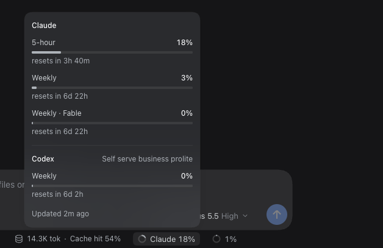
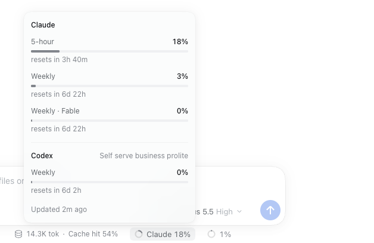

# dsh-usage-limits

A DeepSeek Harness (DSH) Web plugin that shows how much of your Claude and Codex plan limits you have used.

## What it shows

A small ring and label sit beside the composer's context meter, for example `Claude 8%`. The label shows the fullest window across both providers. It takes the warning color at 75% and the danger color at 90%. Click it to open a panel that lists every window for each provider: the 5-hour window, the weekly window, per-model weekly windows such as `Weekly · Opus`, and any extra Codex limits. Each row shows the percent used and when it resets.


 

## Where the data comes from

The plugin reads the OAuth grants DSH already stores when you sign in to a provider:

- `llm-pi-ai/anthropic` for Claude
- `llm-pi-ai/openai-codex` for Codex

It calls these usage endpoints:

- `https://api.anthropic.com/api/oauth/usage`
- `https://chatgpt.com/backend-api/wham/usage`

Neither endpoint is documented, so either may change shape without notice. When a response cannot be read, the plugin keeps showing the last good data and marks it stale.

The plugin never refreshes, writes, or logs tokens. If a stored token has expired, it waits for DSH to refresh it on the next model request. It calls each endpoint at most once every 5 minutes and backs off further after errors. The browser polls the plugin's own route every 60 seconds, which does not reach upstream more often.

## ProviderProxy

A host whose sessions go through [providerproxy](https://github.com/jakehemmerle/providerproxy) holds no DSH sign-in of its own; the proxy holds the Claude and Codex sign-ins on its server. Add a `proxy` block to read those accounts too:

```yaml
      config:
        proxy:
          baseURL: http://gpu.tail47033e.ts.net:4000/v1
          apiKeyEnv: PROVIDERPROXY_API_KEY   # the default
```

The plugin then calls `GET <baseURL>/usage/claude` and `<baseURL>/usage/chatgpt` with the proxy's client token from that environment variable. These show as `Claude (proxy)` and `Codex (proxy)` beside any DSH sign-ins, under the same throttle. Without the variable they count as signed out. The proxy itself reads each upstream at most once a minute and strips the account's email and ids.

## Install

Add an insert row to `~/.dsh/profiles/web/cordis.patch.yml`, then reload the DSH page. Restart DSH if the meter does not appear.

```yaml
- insert:
    - id: usage-limits
      name: /Users/jake/code/dsh-usage-limits/index.js
      config:
        minIntervalMs: 300000
```

The `name` must point at `index.js`, not the package directory, because Node cannot import a directory. DSH finds the browser half through the package's `package.json`. `minIntervalMs` is optional; values below 60000 are raised to 60000.

## Test

```sh
npm install
npm test
```
